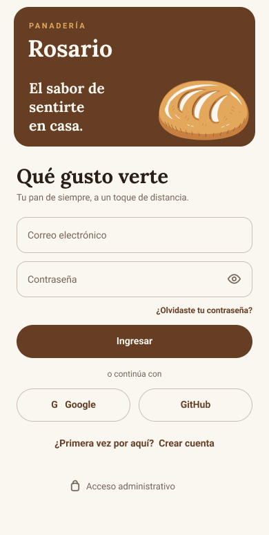
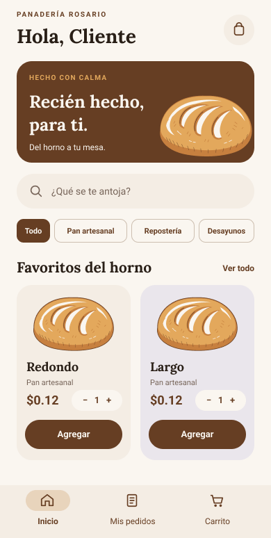
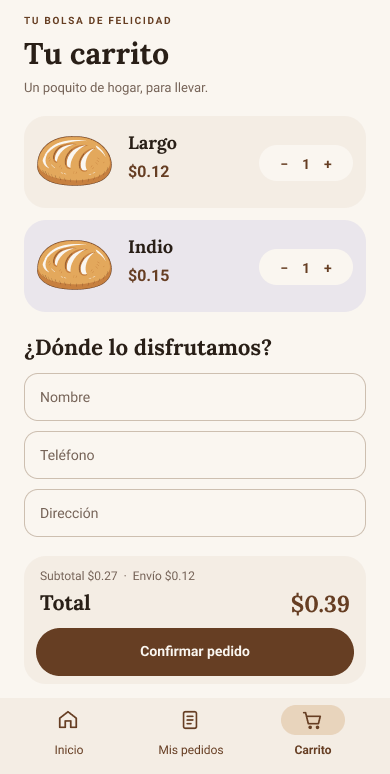
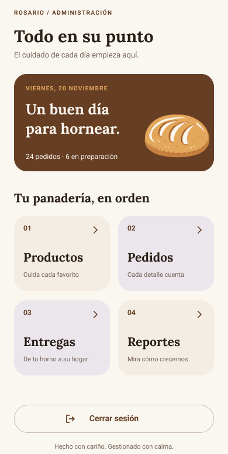
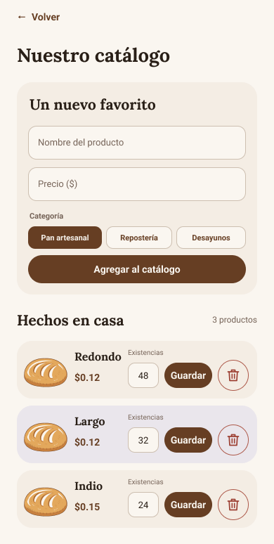
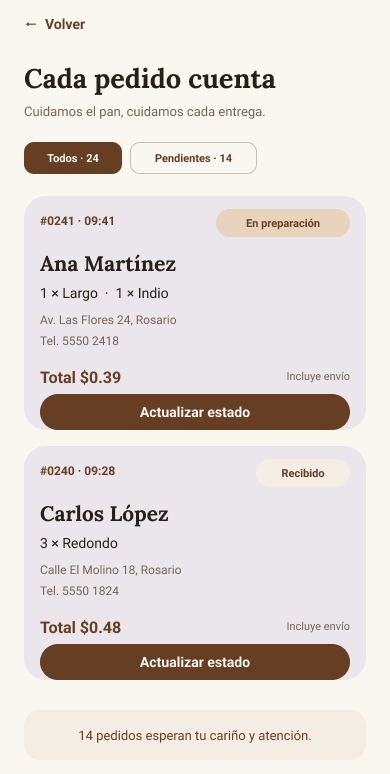
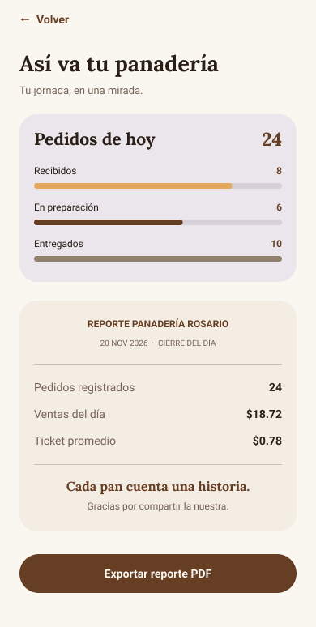

# Panadería Rosario

**Universidad Don Bosco · Dirección de Educación a Distancia**
Desarrollo de Software para Móviles (DSM941) · Proyecto de cátedra

| Estudiante | Carné | Rama |
| --- | --- | --- |
| Christian Geovanni Centeno | CS241743 | `chris-branch` |
| José Alexander Montoya | MQ252529 | `alex-branch` |
| Félix Gabriel Quintanilla Rodríguez | QR230082 | `gabriel-branch` |

Aplicación Android nativa, desarrollada en Kotlin con Jetpack Compose, Firebase
Authentication y Cloud Firestore, para la consulta del catálogo y la gestión de
pedidos a domicilio de Panadería Rosario.

## Problema que resuelve

Panadería Rosario es un emprendimiento que vende pan, repostería, desayunos y cenas, con
servicio de entrega a domicilio. Sus pedidos se atendían mediante comunicación directa con
cada cliente: había que intercambiar productos disponibles, precios, cantidades y datos de
entrega en conversaciones individuales, y con varias solicitudes a la vez era difícil
mantener la información organizada. El cliente, por su parte, no podía consultar la oferta
sin preguntar primero.

La aplicación concentra en un solo lugar el catálogo, la recepción de pedidos y su
seguimiento:

- **El cliente** consulta productos y disponibilidad, arma su pedido, ve el total, indica los
  datos de entrega y sigue el estado del pedido en tiempo real.
- **El administrador** gestiona productos, precios y existencias, recibe los pedidos,
  actualiza su estado hasta la entrega y consulta reportes.

## Funcionalidades

| Módulo | Funciones |
| --- | --- |
| Acceso y usuarios | Registro e inicio de sesión con correo, Google y GitHub (Firebase Authentication). Roles de cliente y administrador. |
| Catálogo | Productos por categoría (pan, repostería, desayunos, cenas) con descripción, búsqueda, filtros, precio y existencias. Vista de detalle con cantidad y total. |
| Pedidos | Carrito con cantidades, cálculo del total, datos de entrega y confirmación transaccional que descuenta existencias. |
| Seguimiento | Historial del cliente con el avance del pedido: Recibido → En preparación → En camino → Entregado. |
| Administración | Alta, edición y baja de productos con descripción, control de existencias y actualización de estados. |
| Entregas | Pedidos en camino con dirección y teléfono de contacto. |
| Reportes | Gráficos de ventas por categoría, productos más vendidos y pedidos por estado, con filtro por período (hoy, 7 días, 30 días, todo). Exportación a PDF. |

## Tecnologías

- **Kotlin 2.0** y **Jetpack Compose** con Material 3 (paleta café y crema).
- **Firebase Authentication**: correo/contraseña, Google (Credential Manager) y GitHub.
- **Cloud Firestore**: usuarios, catálogo, pedidos e historial en tiempo real.
- **Firestore Security Rules**: aislamiento por usuario y permisos de administrador mediante custom claims.
- Android 7.0 (API 24) o superior. Gradle 8.10.2, AGP 8.7.3.

## Diseño UX/UI y Mockups

La interfaz de usuario de **Panadería Rosario** fue diseñada siguiendo una estética artesanal cálida paleta crema, beige y marrón, e implementada de forma nativa en **Jetpack Compose**.

* 🔗 **Prototipo y Mockups en Figma:** [Ver diseño interactivo en Figma](https://www.figma.com/design/bEmEvFYMrlgV7iOo3sYZtT/Panaderia-Rosario?node-id=0-1&t=nsuyFMK8OC02WEgu-1)

### Flujo de Cliente
| Inicio de Sesión | Catálogo de Productos | Carrito y Entrega |
| :---: | :---: | :---: |
|  |  |  |

### Panel de Administración
| Inicio Admin | Gestión de Catálogo | Control de Pedidos | Reportes y Analítica |
| :---: | :---: | :---: | :---: |
|  |  |  |  |

## Arquitectura

```
app/src/main/java/panaderiarosario/
├── model/       Entidades: Producto, Pedido, DetallePedido, Cliente, EstadoPedido
├── service/     Reglas de negocio: productos, pedidos, clientes y reportes
├── data/        FirebaseRepository (Auth + Firestore) y LocalRepository (demostración)
├── ui/          Pantallas Compose: auth/, cliente/, admin/ y tema
├── util/        Validaciones y registro de errores
└── AppState.kt  ViewModel que coordina sesión, carrito y listeners
```

| Colección de Firestore | Contenido |
| --- | --- |
| `usuarios/{uid}` | Perfil del cliente: nombre, teléfono, dirección, correo |
| `productos/{id}` | Catálogo con precio y existencias |
| `pedidos/{id}` | Pedido con UID del cliente, detalle, total, estado y fecha |
| `contadores/pedidos` | Numeración consecutiva de pedidos |

Las reglas están en [`firestore.rules`](firestore.rules).

## Cómo ejecutar

1. Instalar **[Android Studio](https://developer.android.com/studio)**, que ya incluye el JDK 17 y el Android SDK.
2. Clonar el repositorio y abrir la carpeta en Android Studio.
3. Esperar a que Gradle sincronice y ejecutar la configuración **app** en un emulador o teléfono.

Con `app/google-services.json` presente, la app usa Firebase. Sin ese archivo, arranca en
**modo demostración**, con datos guardados en el dispositivo, para probar los módulos sin
conexión. La configuración del proyecto Firebase está explicada en
[`docs/FIREBASE.md`](docs/FIREBASE.md).

Compilar desde la terminal:

```bash
bash gradlew :app:assembleDebug
```

## Entregas

| Etapa           | Material                                                                                                                  |
|-----------------|---------------------------------------------------------------------------------------------------------------------------|
| Etapa 3, Foro 1 | [Informe](docs/DSM941%20-%20Etapa3,%20Foro1-%20QR230082.pdf) · [Video](video/Demostracion%20Panaderia.mp4)                |
| Etapa 3, Foro 2 | [Informe](docs/DSM941%20-%20Etapa3,%20Foro2-%20QR230082.pdf) · [Video](video/Foro%202%20Panaderia%20Demostraci%C3%B3n.mp4) |
| Etapa 3,  Final | [Informe](docs/DSM941%20-%20Entrega%20Final.pdf) · [Video](video/Link)                                                    |

## Licencia

<a rel="license" href="https://creativecommons.org/licenses/by-nc-sa/4.0/deed.es"></a>

Este proyecto está bajo la licencia
[Creative Commons Atribución-NoComercial-CompartirIgual 4.0 Internacional](https://creativecommons.org/licenses/by-nc-sa/4.0/deed.es).
Se permite compartir y adaptar la obra dando crédito a los autores, sin fines comerciales
y bajo la misma licencia. Ver [`LICENSE`](LICENSE).
